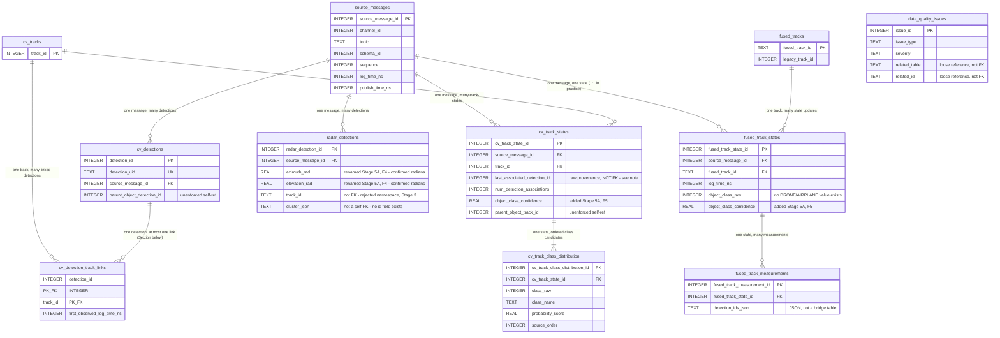

# Entity-Relationship Diagram

Stage 4 deliverable, updated in Stage 5A (`docs/architecture/SCHEMA_REVIEW.md`): two
columns added (`cv_track_states.object_class_confidence`,
`fused_track_states.object_class_confidence`), two radar columns renamed
(`azimuth`→`azimuth_rad`, `elevation`→`elevation_rad`) for unit clarity.
No table, primary key, foreign key, or relationship line changed. Companion
diagram to `docs/architecture/DATABASE_DESIGN.md` (full specification) and
`docs/architecture/TABLE_GRAIN.md` (grain reference). Table names, primary keys, and
foreign keys below are copied exactly from `docs/architecture/DATABASE_DESIGN.md`
Section 5 — see that document for full column lists, nullability,
indexes, and the reasoning behind every relationship (including the ones
deliberately **not** drawn here).

---

## Reading this diagram

- **PK** = primary key. **FK** = foreign key. **UK** = unique key
  (non-primary). **PK_FK** = part of a composite primary key that is also
  a foreign key (`cv_detection_track_links`).
- Quoted labels on some columns and relationships call out places where
  the obvious ER interpretation would be wrong — read them before
  assuming a line means "enforced foreign key."
- `data_quality_issues` has **no relationship lines** to any other table.
  This is deliberate: its `related_table`/`related_id` columns are a
  loose, polymorphic reference (they can point to rows in *different*
  tables depending on `issue_type`) and are intentionally not a real
  foreign key — see `docs/architecture/DATABASE_DESIGN.md` Section 5.10.
- `cv_track_states.last_associated_detection_id` has **no relationship
  line** to `cv_detections`, deliberately (`docs/architecture/SCHEMA_REVIEW.md`
  finding F1) — only the deduplicated `cv_detection_track_links` bridge
  table enforces that relationship, after filtering the 4 confirmed
  orphaned values; enforcing it on this raw column too would reject 4
  otherwise-valid rows.
- The `cv_tracks ||--o{ cv_track_states` and `fused_tracks ||--o{
  fused_track_states` lines both carry a loading-order implication not
  visible in the diagram itself: both parent tables must be **fully**
  populated by an upfront scan before any child row referencing them is
  inserted — see `docs/architecture/DATABASE_DESIGN.md` Section 5.12
  (`docs/architecture/SCHEMA_REVIEW.md` finding F2).

## Cardinalities, stated precisely

| Relationship | Cardinality | Note |
|---|---|---|
| `source_messages` → `cv_detections` | 1 : many | one batch message contains many detections |
| `source_messages` → `cv_track_states` | 1 : many | one batch message contains many track restatements |
| `source_messages` → `radar_detections` | 1 : many | one batch message contains many radar readings |
| `source_messages` → `fused_track_states` | 1 : many (0 or 1 in practice) | `track_states` is confirmed *not* batched (Stage 2) — every real message produces exactly one state row, but the FK's cardinality is drawn as 1:many for schema consistency across all four topics sharing one envelope table |
| `cv_tracks` → `cv_track_states` | 1 : many | a persistent track (17 total) is restated across up to 1,676 state rows |
| `cv_tracks` → `cv_detection_track_links` | 1 : many | a track can be linked to many distinct detections |
| `cv_detections` → `cv_detection_track_links` | 1 : 0 or 1 (observed) | CONFIRMED (Stage 3/4): zero detections in this file are linked to more than one distinct track — see the note below |
| `fused_tracks` → `fused_track_states` | 1 : many | a persistent fused track (103 total) receives up to 521 state updates |
| `fused_track_states` → `fused_track_measurements` | 1 : many | one state update can have several contributing sensor measurements |

**On the `cv_detections` ↔ `cv_detection_track_links` cardinality:** the
schema's foreign key allows a detection to appear in more than one link
row (a real many-to-many is representable), but the *observed data*
(Stage 3, re-confirmed Stage 4) shows every one of the 1,868 linked
detections maps to exactly one track — zero conflicts. The Mermaid diagram
draws the general `||--o{` form because the schema does not forbid
multiple links; it is not literally `||--o|` (one-to-zero-or-one), which
would over-claim a constraint the data merely happens to satisfy so far.
See `docs/architecture/DATABASE_DESIGN.md` Section 5.5.

## Relationships deliberately NOT drawn

These candidate relationships were investigated in Stage 3 and/or Stage 4
and explicitly **not** enforced — see `docs/architecture/DATABASE_DESIGN.md` Section 6
for the full evidence behind each:

- `cv_track_states.parent_object_track_id` → `cv_tracks.track_id`
  (weak_heuristic, 0 populated in this file)
- `cv_detections.parent_object_detection_id` → `cv_detections.detection_id`
  (0 populated occurrences)
- `radar_detections` cluster self-reference (always empty; no id field
  exists to reference even if populated)
- `radar_detections.track_id` ↔ `cv_tracks.track_id` /
  `fused_tracks.fused_track_id` (zero observed value overlap in every
  tested pairing, including the one pairing with matching protobuf types)
